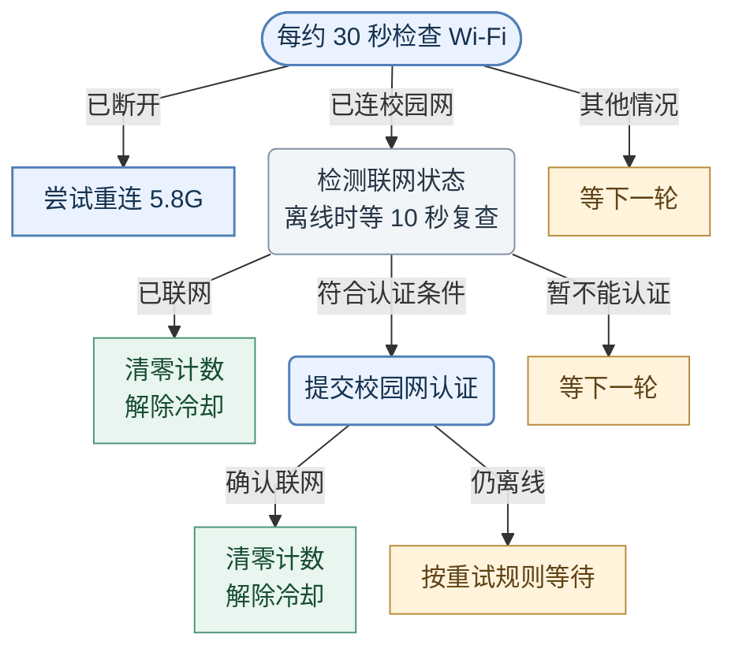

# 校园网自动登录与 DNS 修复

本项目适用于使用本校 Dr.COM 网页认证的 `ChinaTelecom-EDU5.8G` 和 `ChinaTelecom-EDU2.4G`。**普通用户直接下载 Windows 64 位分发包，解压即可使用，无需安装 Python。**

[下载 Windows 64 位分发包](./CampusNetworkRecovery-Windows-x64.zip)

## 首次使用

1. 将 ZIP **完整解压到一个固定文件夹**，双击 `CampusNetworkRecovery.exe`。
2. 点击「设置账号」，输入自己平时在校园网认证页使用的账号和密码。
3. 连接校园 Wi-Fi，暂时保留待认证状态。网页弹出时，先别点网页上的「连接网络」。
4. 回到程序，点击「单次认证」。出现「认证成功，已确认恢复上网」后，点击「启用自启动」。
5. 界面显示后台恢复正在运行后，就可以关闭窗口。后台会继续检查校园网，在网络恢复且需要认证时尝试重新登录。

如果第 4 步显示「当前已联网」，等下次校园网需要认证时再执行单次认证。已经联网时，程序会跳过登录，本次无法完成首次认证验证。

## Wi-Fi 已连接，但认证页没弹出、网络也不可用

如果是手动 DNS 导致认证页无法打开，可以单独运行 DNS 修复工具：

1. 连接出问题的校园 Wi-Fi，双击 `00-repair-campus-dns.cmd`，在 Windows 管理员授权窗口选择「是」。
2. 工具会恢复自动获取 DNS，并清除 DNS 缓存。完成后断开并重新连接校园 Wi-Fi。
3. 如果认证页仍未自动弹出，在浏览器地址栏输入 `http://www.msftconnecttest.com/redirect`，尝试触发认证跳转。

请将 `00-repair-campus-dns.cmd` 和 `campus_dns_repair.ps1` 保留在同一文件夹。校园网或认证服务器故障时，需要等网络侧恢复。

## 日常管理

| 想做什么 | 操作 |
| --- | --- |
| 查看当前连接和后台状态 | 打开 EXE，点击「刷新状态」 |
| 更新工具保存的账号或密码 | 打开 EXE，点击「设置账号」，重新输入完整账号和密码，点击「加密保存」 |
| 停止后台并关闭自启动 | 点击「停止并取消自启动」 |
| 移动文件夹或替换 EXE | 先停止并取消自启动。移动或替换后，从新位置打开 EXE，再点击「启用自启动」 |
| 排查后台是否在运行 | 在 Windows 任务计划程序中查看 `CampusNetworkRecovery`，或在任务管理器中查找 `CampusNetworkRecovery.exe` |

后台以约 30 秒为周期检测网络。校园网认证返回 `ret_code=1` 时，至少等 20 秒，在下一轮确认仍需认证时再试。累计 11 次明确拒绝后，后台暂停提交 10 分钟，并继续检测网络和尝试恢复断开的 Wi-Fi。

冷却到期后，每轮最多提交 5 次认证。请求发出后超时也占用本轮一次机会，Wi-Fi 掉线或认证页打不开时则不会消耗次数。明确拒绝后仍至少等 20 秒，临时认证失败仍按 60、120、240、最多 300 秒的间隔退避。本轮用完且仍离线时，再冷却 10 分钟。重启后会保留冷却截止时间和本轮剩余次数。检测到已经联网（包括网页手动认证成功），或重新保存账号密码，都会结束冷却并恢复正常流程。

启用自启动后，Windows 会在登录、唤醒或解锁时检查是否需要启动后台，并定期补启动缺失的进程。唤醒后请留一点时间让 Wi-Fi 恢复连接。

### 后台恢复流程图

只有确认仍处于校园网、认证页可信、等待时间已到，才会提交认证。Wi-Fi 断开时，识别到无线网卡才会尝试重连。每条分支处理完毕后，都会回到下一轮网络检查。

「设置账号」只更新工具在当前 Windows 用户下保存的登录信息。学校账号本身的密码需要在学校提供的入口修改，再把新密码填进工具。设置窗口会要求重新输入两项。保存成功后，单次认证状态会变为「待验证」，当前在线的校园网会话可以继续使用。下次需要认证时，运行「单次认证」，成功后再点「启用自启动」。`00-repair-campus-dns.cmd` 只修复 DNS，源码版请用 `01-account-setup.cmd` 修改工具保存的账号。

## 换电脑使用

把 ZIP 完整解压到另一台 64 位 Windows 电脑后，用该电脑的 Windows 用户重新设置校园网账号、完成单次认证并启用自启动。无线网卡名称由程序识别，客户端 IP、MAC 和接入设备参数在连接时获取。无需复制旧电脑的凭据文件或计划任务。

自动登录针对本校的两个 Wi-Fi 名称和当前 Dr.COM 认证接口。学校更换 Wi-Fi 名称、认证服务器或登录流程后，需要重新适配。两种 Wi-Fi 已连接时都可以尝试认证，完全掉线时工具会主动尝试重连已保存的 `ChinaTelecom-EDU5.8G`。

## 常见提示

| 提示 | 可以怎么做 |
| --- | --- |
| 请先连接支持的校园 Wi-Fi | 确认连接的是上述两个校园 Wi-Fi 之一，再试一次 |
| 本次认证被服务器拒绝 | 稍后再试，或先在校园网网页确认账号可用 |
| 认证服务器暂未接受登录，或暂未确认恢复上网 | 稍后重试。也可以先打开网页检查校园网是否正常，再查看日志 |
| 后台恢复显示自动认证冷却中 | 校园网仍需要认证时，后台将在冷却结束后重新尝试。也可以在网页手动认证 |

点击「打开日志目录」可以查看 `recovery.log` 和本机认证诊断记录。

## 安全与隐私

- **账号密码在本机加密保存。** 点击「加密保存」后，程序使用 Windows 数据保护 API（DPAPI）按当前 Windows 用户加密账号和密码，将密文保存到 `%LOCALAPPDATA%\CampusNetworkRecovery\credentials.json`。换电脑或换 Windows 用户时，在新环境重新填写即可。
- **凭据仅用于校园网认证。** 程序只在识别到受支持的校园 Wi-Fi、检测到需要认证并核对本机 IP 和 MAC 后，才向配置的学校认证服务器提交凭据。程序没有向项目作者上传凭据的功能，也不会把账号密码或完整认证请求写入运行日志。联网检测请求不携带账号密码。

分享工具时只需发送分发包。凭据加密和认证逻辑可以在 [campus_recovery.py](./campus_recovery.py) 中查看。

## 从源码运行

源码版需要 Windows 和 Python 3.10 或更新版本，命令行需能运行 `python`。在项目目录执行 `python campus_recovery.py` 可打开同样的图形界面。也可以双击以下入口：

| 文件 | 用途 |
| --- | --- |
| `01-account-setup.cmd` | 在本机设置账号密码 |
| `02-authenticate-once.cmd` | 运行单次认证 |
| `03-enable-startup.cmd` | 启用自启动并启动后台 |
| `04-stop-and-disable.cmd` | 停止后台并取消自启动 |
| `05-status.cmd` | 查看当前状态和日志位置 |

### 使用 CMD 时输错了账号或密码

1. 重新双击 `01-account-setup.cmd`，输入完整的正确账号和密码，再点击「加密保存」。这会覆盖旧凭据，并解除自动认证暂停。
2. 连接校园 Wi-Fi，等到网络需要认证时，双击 `02-authenticate-once.cmd`，按窗口提示操作。如果显示 `RESULT: online`，等下次需要认证时再试。
3. 看到 `RESULT: authenticated` 后，如果要使用后台自动登录，运行 `03-enable-startup.cmd`。

`02-authenticate-once.cmd` 会读取已保存的账号尝试登录。要重新输入账号密码，请回到第 1 步。

源码版和 EXE 版使用同一份本机账号配置和计划任务。日常使用选择其中一种运行方式即可。
